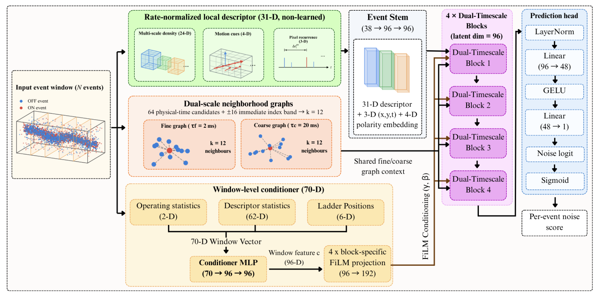

# EDNet

EDNet labels each event of a DVS stream as scene-generated or
background-activity noise. Its front end is built so that what the learned
backbone sees does not drift with the event rate: local density is reported
relative to the count expected under uniform background activity at the
window's own measured rate, the two neighborhood graphs draw candidates from a
physical-time interval rather than a fixed event-index band, and window-level
rate information is supplied separately through FiLM conditioning instead of
being allowed to redefine the local features implicitly.

The model has **0.576 M parameters**, is trained only on ED24 (DAVIS346,
346x260), and is applied zero-shot to every other benchmark.

---




## Links

- **Try it online** — [Streamlit](https://eventdenoise.streamlit.app/). Upload
  an event file and get the denoised stream back as frames or an MP4. Nothing
  to install.
- **Supplementary videos** — [Google Drive](https://drive.google.com/drive/folders/1UubnpH5IUzfDqGkWcauZxuHCOur-xrUC?usp=drive_link).
  Twenty DND21 clips showing raw input, EDNet output and ground truth side by
  side, at ten noise levels on both recordings.
- **Sample recordings** — [Google Drive](https://drive.google.com/drive/folders/1qAGS_lm8tY1nAQ566eErWZt1fOftVZkp?usp=drive_link).
  Small E-MLB, DND21 and ED24 files for trying the demo without downloading a
  full dataset.

---

## Requirements

Developed and reported on Python 3.10 with PyTorch 2.7.1 + CUDA 11.8, on a
single NVIDIA RTX A4000 (16 GB).

```bash
python -m venv venv
venv\Scripts\activate          # Windows;  source venv/bin/activate on Linux
pip install -r requirements.txt
```

Install the PyTorch build that matches your CUDA version from
<https://pytorch.org/get-started/locally/> rather than relying on the plain
`pip install torch` in `requirements.txt`.

A GPU is required for the evaluation scripts in any practical time. Training
the published model takes about 10.4 hours on one A4000.

---

## Pretrained model

`best.pth` is the checkpoint every number in the paper is computed from:
epoch 26 of a 28-epoch run, selected on held-out ED24 validation scenes only.
No external benchmark was used for checkpoint selection.

It carries its own config, so the evaluation scripts rebuild the architecture
from the file and do not need the training flags repeated.

---

## Datasets

None of the datasets are redistributed here. Download them from their original
sources and point the scripts at them.

**ED24** (training) — released with EDformer [1]. The loader expects:

```
ED24/
  <scene>/
    <scene>_1.5.csv
    <scene>_1.6.csv
    ...
    <scene>_3.5.csv
```

**DVSCLEAN** [2] · **DND21** [3] · **E-MLB** [4] — evaluation only; see the
paper for the protocols.

Event files are read as `[timestamp, x, y, polarity, label]`, where **label 1
is noise**. `ed24_data.verify_label_convention` checks this on each corpus
rather than assuming it.

[1] B. Jiang, B. Xiong, B. Qu, M. S. Asif, Y. Zhou and Z. Ma, "EDformer:
Transformer-based event denoising across varied noise levels," *ECCV 2024*,
pp. 200–216.
[2] H. Fang, J. Wu, L. Li, J. Hou, W. Dong and G. Shi, "AEDNet: Asynchronous
event denoising with spatial-temporal correlation among irregular data,"
*ACM MM 2022*, pp. 1427–1435.
[3] S. Guo and T. Delbruck, "Low cost and latency event camera background
activity denoising," *IEEE TPAMI*, vol. 45, no. 1, pp. 785–795, 2023.
[4] S. Ding, J. Chen, Y. Wang, Y. Kang, W. Song, J. Cheng and Y. Cao, "E-MLB:
Multilevel benchmark for event-based camera denoising," *IEEE TMM*, vol. 26,
pp. 65–76, 2024.

## Reproducing the paper

Windows PowerShell uses `` ` `` for line continuation; the examples below use
`\` for readability. Paths use forward slashes and work either way.

### Tables I and II -- DVSCLEAN, zero-shot cross-sensor

```bash
python eval_dvsclean_snr.py --ckpt best.pth \
    --root DVSCLEAN/simulated_data \
    --sensor 1280 720 --time_unit s --force_polarity 2 --N 10240
```

### Table III and Fig. 3 -- DND21

```bash
python eval_auc_dnd21.py --ckpt best.pth \
    --auc_root AUC_test \
    --datasets mix driving_mix --freqs 1 2 3 4 5 6 7 8 9 10 --N 10240
```

### Table IV -- E-MLB

```bash
python eval_emlb.py        # see --help; flags not reproduced here
python emlb_night_table.py
```

### Tables V and VI -- ablations and the window stress test

The ablation checkpoints are not released; only the full model's weights are.
The code to reproduce all six variants is here, and they retrain from scratch
under the same recipe. The registry lives in `edn_ablate.py`; `python
edn_ablate.py` prints the variants with their parameter counts.

```bash
# train all six (long)
python supervise_ablations.py --root path/to/ED24 \
    --variants a1_rawdens a2_idxgraph a3_nofilm a4_nomotion a5_nopixel a6_noaug \
    --out_root runs/abl --epochs 28

# evaluate every variant under both protocols, then build Table V
python eval_ablations.py --runs runs/abl \
    --dvsclean_root DVSCLEAN/simulated_data --dnd21_root AUC_test \
    --logs logs --require_epochs 28 --collect --tex sec_ablation_table.tex

# Table VI: re-evaluate four checkpoints at three window lengths, no retraining
python stress_window.py --runs runs/abl \
    --dvsclean_root DVSCLEAN/simulated_data --dnd21_root AUC_test \
    --variants full a1_rawdens a2_idxgraph a3_nofilm \
    --Ns 4096 10240 20480 --csv stress_window_results.csv
```

### Inference cost (Section VI-B)

```bash
python bench_runtime.py --ckpt best.pth \
    --ed24_root path/to/ED24 --Ns 4096 10240 20480 \
    --tex tab_runtime.tex --json runtime.json

# batched throughput
python bench_runtime.py --ckpt best.pth \
    --dvsclean_root DVSCLEAN/simulated_data \
    --Ns 10240 --batch 8 --windows 32 --no_stages
```

Timing covers descriptor construction, both neighborhood graphs, the four
dual-timescale blocks and the prediction head, and excludes data loading and
host-to-device transfer. It cycles through several distinct windows rather than
repeating one, because the hashed descriptor and the graph are data-dependent.

---

## Training from scratch

```bash
python train_edn.py path/to/ED24 \
    --N 10240 --batch_size 8 --epochs 28 \
    --lr 1e-3 --weight_decay 1e-2 --seed 230086 \
    --scale_mode absolute --augment \
    --out_dir runs/ednet
```

**The script defaults are not the published configuration.** `--N`,
`--batch_size`, `--epochs` and `--weight_decay` all default to other values;
running `train_edn.py <root>` with no flags trains a different model. The
command above matches Section IV-B.

Splits are by scene, never by window: 85 training scenes and 15 validation
scenes, so temporally adjacent windows of one recording cannot appear in both.
Checkpoint selection maximizes the mean of clean-ED24 validation AUC and the
AUC on a deterministic 10 Hz/pixel shot-noise probe built from the same
held-out scenes.

To train one ablation variant:

```bash
python train_edn.py path/to/ED24 --variant a1_rawdens [same flags as above]
```

---

## Repository map

| File | What it does |
| --- | --- |
| `edn_model.py` | The model: density descriptor, physical-time kNN, dual-timescale blocks, head, loss |
| `edn_ablate.py` | Ablation switches and variant registry; re-exports `EDNet`/`config_from_checkpoint` so an eval script changes one import line |
| `ed24_data.py` | Event file reading and caching, per-window normalization, scene splits, shot-noise injection, label-convention checks |
| `event_io.py` | DVSCLEAN file reader |
| `train_edn.py` | Training loop, augmentation, checkpoint selection |
| `eval_dvsclean_snr.py` | Tables I-II: RER, NSR, precision, F1, per-scene AUC |
| `eval_auc_dnd21.py` | Table III: per-rate AUC on both DND21 recordings |
| `eval_emlb.py`, `emlb_night_table.py` | Table IV: E-MLB ESR |
| `eval_mesr_dnd21.py` | MESR on DND21 |
| `supervise_ablations.py`, `run_ablations.py` | Train the ablation variants, with restart-on-stall |
| `eval_ablations.py`, `collect_ablations.py` | Table V: run every variant under both protocols, then build the LaTeX table |
| `stress_window.py` | Table VI: re-evaluate at 4096 / 10240 / 20480 events with no retraining |
| `bench_runtime.py` | Inference cost: latency, throughput, peak memory, stage decomposition |
| `probe_sensor_api.py` | Sensor-geometry probe |
| `best.pth` | The published checkpoint |

---

**Single seed.** Every configuration is one run at seed 230086. Training
variance is therefore not measured, and may be larger than several of the
differences reported in the ablation table.

---

## Citation

```bibtex
@article{chanda2026ednet,
  title   = {Normalizing the Rate, Not the Scale: Event-Camera Denoising with EDNet},
  author  = {Chanda, Tanmoy and Barua, Hrishav Bakul and Pal, Arindrajit and
             Bozorgtabar, Behzad and Mahapatra, Dwarikanath and Roy, Sudipta},
  year    = {2026},
  note    = {Under review}
}
```

Released under the MIT License; see `LICENSE`.

---

## Acknowledgements

ED24 and the EDformer baseline, DVSCLEAN, DND21 and E-MLB are the work of their
respective authors; we thank them for releasing the data and the reference
numbers that make this comparison possible.
